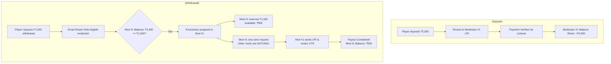

# Implementation Plan: Moderator Balance Sheets & Exclusive Payout Routing

This document specifies the technical architecture, database changes, business logic, and UI updates required to implement decentralized balance sheets for moderators, personal deposit filtering, and exclusive 1-to-1 withdrawal routing to prevent double payouts.

---

## 1. System Objectives

1. **Decentralized Balance Sheet (Cash Desk Float):**  
   Track exact cash inflow (deposits received) and outflow (withdrawals sent) per moderator.
2. **Deposit Isolation:**  
   Moderators only see incoming deposit requests routed specifically to their assigned UPI ID.
3. **Exclusive 1-to-1 Payout Routing (Zero Double-Payouts):**  
   Each pending withdrawal request is routed to **strictly ONE moderator** who has sufficient liquid balance ($\text{Available Balance} \ge \text{Withdrawal Amount}$). The amount is reserved so other moderators never see or pay the same request.
4. **Super Admin Transparency:**  
   Super Admin dashboard shows the **Total Platform Fleet Balance**, plus individual balance sheets for every moderator in the fleet.

---

## 2. Architecture & Data Flow



---

## 3. Database Schema Updates

### A. Update `Withdrawal` Model in Prisma
Add fields to track exclusive assignment and timeout failover:
```prisma
model Withdrawal {
  id                  String    @id @default(uuid())
  userId              String
  user                User      @relation(fields: [userId], references: [id], onDelete: Cascade)
  amount              Float
  upiId               String
  status              String    @default("PENDING") // PENDING, PROCESSING, COMPLETED, REJECTED
  payoutUtr           String?   @unique
  
  // Exclusive assignment fields
  assignedModeratorId String?   // Set to exactly ONE moderator ID
  assignedAt          DateTime? // Timestamp when assigned (for 15-min failover)
  processingById      String?   // Locked operator during active payment
  processedById       String?   // Final operator who submitted payout UTR
  reason              String?
  createdAt           DateTime  @default(now())
  updatedAt           DateTime  @default(now()) @updatedAt

  @@index([userId])
  @@index([assignedModeratorId, status])
}
```

### B. Update `UpiAccount` Model
Maintain cached float balances for instant $O(1)$ lookups and routing decisions:
```prisma
model UpiAccount {
  // Existing fields: id, upiId, receiverName, dailyLimit, assignedUserId...
  totalDeposited     Float     @default(0.0) // Cumulative approved deposits
  totalPaidOut       Float     @default(0.0) // Cumulative completed withdrawals
  currentBalance     Float     @default(0.0) // totalDeposited - totalPaidOut
  reservedPayouts    Float     @default(0.0) // Currently assigned pending payouts
  
  // Available to accept new payouts: currentBalance - reservedPayouts
}
```

---

## 4. Backend Engine Implementation

### Step 1: Deposit Processing & Balance Credit
In [`payment.service.ts`](file:///home/gulshan/Projects/MoneyGame/apps/server/src/modules/payment/payment.service.ts):
* When a deposit is approved (`approve`):
  * Increment `totalDeposited` and `currentBalance` on the `UpiAccount` matching the deposit's `receivingUpi`.

### Step 2: Exclusive Payout Assignment Engine
In [`wallet.service.ts`](file:///home/gulshan/Projects/MoneyGame/apps/server/src/modules/wallet/wallet.service.ts):
* When a player creates a withdrawal (`requestWithdrawal`):
  * Query all active moderators where $(\text{currentBalance} - \text{reservedPayouts}) \ge \text{withdrawal.amount}$.
  * Pick **one** moderator using round-robin among eligible accounts with balance.
  * If an eligible moderator is found:
    * Set `assignedModeratorId = chosenModerator.id`, `assignedAt = new Date()`.
    * Increment `reservedPayouts += withdrawal.amount` on chosen moderator's account.
  * If no moderator currently has enough float:
    * Mark as unassigned (`assignedModeratorId = null`) for Super Admin manual clearance or wait until new deposits arrive.

### Step 3: Payout Settlement & Balance Deduction
* When the assigned moderator submits the bank UTR (`completeWithdrawal`):
  * Verify `assignedModeratorId === req.user.id` or `actor.role === 'SUPER_ADMIN'`.
  * Deduct `reservedPayouts -= withdrawal.amount`.
  * Deduct `currentBalance -= withdrawal.amount`.
  * Increment `totalPaidOut += withdrawal.amount`.
  * Record `processedById = req.user.id` in audit log.

### Step 4: Auto-Failover & Reassignment Watchdog
* Add a periodic check (or trigger on fetch):
  * If a withdrawal remains `PENDING` with an assigned moderator for $> 15$ minutes without being claimed:
    * Release `reservedPayouts` from that moderator.
    * Reassign to the next available moderator with sufficient balance.

### Step 5: Route Filtering & RBAC
In [`api.routes.ts`](file:///home/gulshan/Projects/MoneyGame/apps/server/src/routes/api.routes.ts) & [`moderator.routes.ts`](file:///home/gulshan/Projects/MoneyGame/apps/server/src/routes/moderator.routes.ts):
* `GET /admin/deposits`:
  * If `req.user.role === 'MODERATOR'`: Filter `where: { receivingUpi: myAccount.upiId }`.
* `GET /admin/withdrawals`:
  * If `req.user.role === 'MODERATOR'`: Filter `where: { assignedModeratorId: req.user.id }`.
  * Guaranteed: Moderator only sees payouts assigned exclusively to them.
* `GET /admin/stats`:
  * Add `totalFleetBalance = totalDepositVolume - totalPayoutVolume`.

---

## 5. UI Updates

### A. Super Admin App (`apps/admin-app`)
1. **Dashboard KPI Card:**
   * Add **Current Fleet Float (Vault)** card next to "Total Deposited" and "Total Withdrawn".
   * Shows active cash across all moderator bank accounts.
2. **Moderator Fleet Screen (`ModeratorsScreen`):**
   * Expand moderator cards to show their individual live balance sheet:
     * Deposits Received: ₹XX,XXX
     * Payouts Sent: ₹YY,YYY
     * **Current Float: ₹ZZ,ZZZ**
     * Reserved Payouts: ₹R,RRR
3. **Withdrawals Screen (`WithdrawalsQueueScreen`):**
   * Show assigned operator badge on each withdrawal card (e.g. `Assigned to @desk_1`).

### B. Moderator App (`apps/moderator-app`)
1. **Top Balance Sheet Header:**
   * Modern banner displaying:
     * **Available Float: ₹X,XXX**
     * *Total Inflow: ₹Y,YYY | Total Outflow: ₹Z,ZZZ*
2. **Personal Deposits Feed:**
   * Clean list showing strictly deposits sent to their assigned UPI ID.
3. **Assigned Payouts Queue:**
   * Shows only withdrawal requests assigned exclusively to this device.
   * Action button: **"Copy UPI & Pay"** $\rightarrow$ opens bank app $\rightarrow$ prompt for 12-digit IMPS UTR to complete.

---

## 6. Verification & Test Plan

1. **Unit & Integration Tests (`apps/server/tests/moderator.test.ts`):**
   * Test exclusive assignment: 2 active moderators with balance $\rightarrow$ withdrawal assigned to exactly one; second moderator sees empty queue.
   * Test double-payout block: Second moderator attempting to claim throws `403`.
   * Test balance sheet math: Deposit credits balance $\rightarrow$ assignment reserves balance $\rightarrow$ completion permanently deducts balance.
   * Test 15-minute timeout failover to next eligible moderator.
   * Test deposit filtering: Moderator A only sees deposits for UPI A.
2. **App Builds & Tests:**
   * Run `npm test` across all server suites and migrations.
   * Run `flutter test` and `flutter analyze` on both `apps/admin-app` and `apps/moderator-app`.
   * Recompile debug & release APKs for `apps/moderator-app`.

---

## 7. Implemented behavior and rollout (22 October 2026)

The implementation adds SQLite and PostgreSQL migration `20261022020000_moderator_float`, a cash-desk ledger and cached balances, exclusive payout assignment, scoped deposit and withdrawal APIs, and Flutter balance/assignment screens. The existing admin web payout flow also claims before payment so it remains compatible with the server safeguards.

### Accounting decisions

- Cash inflow uses the actual approved `Deposit.totalAmount`, including matching paise. Player wallets continue receiving `baseAmount`.
- A standalone unmatched receipt credits cash float when it is assigned to a player. A receipt matched to a deposit is counted only once. Unresolved receipts are excluded from available float.
- `CashDeskEntry` records each deposit, completed payout and opening adjustment with a unique source key. Each entry and its cached account update commit in the same serializable transaction. Monetary comparisons and calculations use integer paise.
- `currentBalance = totalDeposited - totalPaidOut + openingAdjustment`; `availableBalance = currentBalance - reservedPayouts`.
- Fleet float sums the tracked UPI accounts, including inactive accounts still holding funds. It is separate from player wallet credit totals and externally funded admin payouts. A bank statement remains necessary to reconcile cash moved outside the application.
- The dashboard and solvency audit no longer count an assigned receipt again when it already belongs to an approved deposit.

### Exclusive payout lifecycle

1. Request creation locks the player's wallet and atomically assigns/reserves one eligible cash desk. Eligibility requires an active moderator, active account, confirmed float, online listener and sufficient available balance. Eligible desks rotate in order independently of the deposit cursor.
2. Each moderator's list and mutation endpoints enforce ownership. Other moderators receive HTTP 403 on payout or deposit mutations. Filtering applies to status and pagination queries too.
3. The operator must claim before opening the payment action. A claimed `PROCESSING` payout stays with that operator. Returning to the bank action rechecks the claim. Completing or rejecting releases the reservation exactly once; completion also posts the cash debit.
4. Unclaimed `PENDING` assignments expire after 15 minutes. The watchdog releases the old reservation and tries a different eligible desk. If none qualifies, the request remains unassigned. Routing retries after approvals, on queue fetches, and every 60 seconds. Processing payouts never expire or automatically reassign.
5. Super Admin can reassign only unclaimed payouts. A normal admin claim of an assigned payout retains its original funding account. An unassigned payout requires explicit `EXTERNAL` funding at claim time; that settlement does not debit a moderator's float.
6. Super Admin can resolve a processing payout through **Reconcile bank outcome**, after checking with the operator and the bank. Recording a completed payment requires its UTR and an evidence note; confirming no payment refunds the player. This records the existing bank outcome and never initiates or reassigns a payment. It is audited.
7. An account with active payouts cannot change operator. Receiving addresses with deposit or cash-ledger history cannot be edited. Disable and replace them instead.
8. Authenticated socket invalidations refresh the moderator and admin screens; 15-second polling provides a fallback. Socket invalidations contain no account or payout details.

### Existing installations

The old schema does not reliably identify the bank account used for historical payouts. The migration therefore backfills known deposit inflows and standalone assigned receipts, preserves legacy processing owners, and sets existing accounts to `floatReady = false`. It does **not** guess historical payout attribution. Totals remain provisional and these accounts cannot receive new automatic assignments until reconciled.

After deploying the migration and matching server/app builds:

1. Resolve any legacy processing payouts with their original operator, or use Super Admin bank reconciliation.
2. In **Moderators → Confirm opening bank balance**, enter the reconciled cash attributable to approved MoneyGame payments in that UPI's bank account and a reconciliation note. Exclude uncredited receipts and personal funds; those receipts will credit the tracked balance when approved.
3. The one-time, audited opening adjustment absorbs historical payouts and other prior cash differences. Historical payouts remain in withdrawal history; the account's `totalPaidOut` tracks payouts attributed by the new flow. The adjustment is shown separately.
4. New accounts created after migration start at zero with confirmed float. Existing listener connectivity and account activation requirements still apply.

Migrations have been exercised against isolated test databases. They have not been applied to the workspace's persistent database or a production deployment. PostgreSQL schema validation passes; runtime concurrency tests currently exercise SQLite, not a live PostgreSQL instance.

### Validation

- All 10 server suites pass, including `moderator_float.test.ts` for concurrent reservations, one-owner visibility, cross-account denial, duplicate settlement/UTR handling, timeout failover, processing locks, rejected reservation release, bank reconciliation and ledger conservation.
- All 5 migration tests pass, including legacy inflow backfill without double counting and preservation of processing ownership.
- Shared types, server and admin web builds pass.
- Both Flutter apps pass analysis and tests. The moderator widget test checks available/reserved float and hides the bank action until a successful claim.
- Moderator Android debug and release APKs build successfully (`apps/moderator-app/build/app/outputs/flutter-apk/`).

Manual bank transfers still depend on operators following the claim and reconciliation workflow. The server prevents competing assignments and duplicate ledger settlement; it cannot stop a second transfer made directly in an unrelated banking app.
